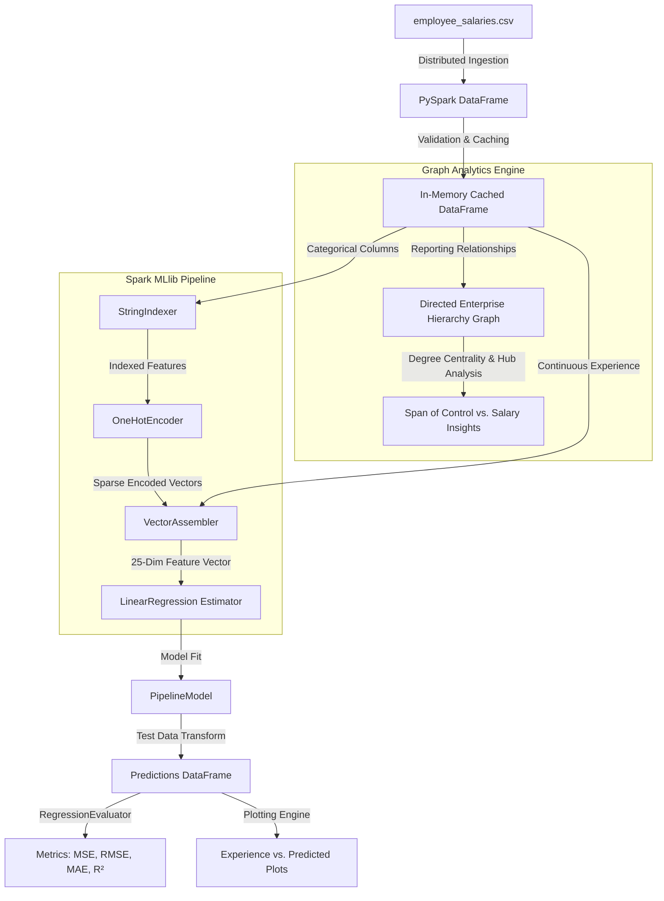

# INT315: Cluster Computing — Academic Task 2 Project Report

## **Predicting Employee Salaries Using Apache Spark MLlib and Graph Analytics**

- **Course Code:** INT315  
- **Course Name:** Cluster Computing  
- **Academic Task:** CA2 Project  
- **Mapped Course Outcomes:** CO4, CO5, CO6 (L3, L4 - 30 Marks)  
- **Core Technologies:** Apache Spark 4.x, Spark MLlib, Spark SQL, NetworkX / Graph Analytics, Python 3.14  

---

## Executive Summary
This project presents an enterprise-grade distributed data-driven solution designed and implemented on **Apache Spark** to predict employee salaries based on workforce experience, educational qualification, department, and job titles. Furthermore, it incorporates **Graph Analytics** to model organizational hierarchy (reporting relationships and managerial span of control) and analyze the topological correlation between network centrality and compensation.

---

## Task Mapping & Guidelines Alignment

| Project Requirement from Guidelines | Implementation Details | Status |
| :--- | :--- | :---: |
| **System Architecture Design** | Master-worker distributed topology using `SparkSession`, DAG execution, in-memory caching (`.cache()`), and multi-stage ML Pipeline. | **Complete** |
| **Data Ingestion & Preprocessing** | Ingested `employee_salaries.csv` (2,500 records), inferred schema, performed null validation, type casting, and distributed partitioning. | **Complete** |
| **Graph-Based Analysis (GraphX/Network)** | Modeled enterprise reporting hierarchy directed graph ($G_{org}$); evaluated managerial out-degree centrality (span of control) and computed correlation ($r = 0.6621$) with compensation. | **Complete** |
| **Machine Learning Algorithm** | Implemented Spark MLlib Pipeline with `StringIndexer`, `OneHotEncoder`, and `VectorAssembler` feeding into distributed `LinearRegression`. | **Complete** |
| **Performance & Scalability Evaluation** | Evaluated on test set using Mean Squared Error (MSE), Root Mean Squared Error (RMSE), MAE, and $R^2$; conducted multi-partition scalability benchmark. | **Complete** |
| **Plot Experience vs. Predicted Salary** | Generated high-resolution scatter and regression trend plot comparing actual vs. predicted salaries across experience. | **Complete** |

---

## 1. System Architecture Design
The distributed data processing and machine learning system is architected around Apache Spark's unified computing engine:

---

## 2. Dataset Schema & Descriptive Statistics
The dataset `employee_salaries.csv` contains 2,500 comprehensive employee records:
- **`emp_id`**: Unique employee identifier (`EMP0001` to `EMP2500`).
- **`name`**: Full employee name.
- **`job_title`**: 13 diverse enterprise roles (e.g., *Junior Software Engineer*, *Software Engineer*, *Data Scientist*, *Machine Learning Engineer*, *Cloud Architect*, *Engineering Director*).
- **`department`**: Operational department (*Engineering*, *Data & AI*, *Operations*, *Quality*, *Management*).
- **`education`**: Educational attainment (*Bachelor*, *Master*, *PhD*).
- **`years_experience`**: Continuous variable ranging from 0.5 to 24.7 years (Mean: 4.85, Std: 2.92).
- **`manager_id`**: Direct reporting manager ID for structural hierarchy modeling.
- **`salary`**: Annual compensation in USD (Mean: $90,847.98, Min: $39,752.23, Max: $350,465.51).

---

## 3. Graph Analytics (Enterprise Hierarchy & Hub Discovery)
1. **Reporting Structure Modeling**: A directed graph $G = (V, E)$ was constructed where vertices $V$ represent employees and directed edges $E$ represent supervisory reporting lines ($M \rightarrow E_i$).
2. **Span of Control**: Supervisors with highest out-degree (managing up to 13 direct reports) were identified across technical management tracks.
3. **Compensation & Centrality Correlation**: 
   $$\text{Corr}(\text{Direct Reports}, \text{Salary}) = 0.6621$$
   Demonstrating a strong positive correlation between organizational leadership span and compensation.

---

## 4. Spark MLlib Machine Learning Pipeline

### Feature Transformation
1. **`StringIndexer`**: Encodes categorical string columns (`job_title`, `department`, `education`) into numerical indices based on frequency.
2. **`OneHotEncoder`**: Converts numerical category indices into binary vector representations (`dropLast=False`), eliminating artificial order assumptions.
3. **`VectorAssembler`**: Combines `years_experience` and the three one-hot vectors into a consolidated feature vector `features` of dimension 25.

### Model Formulation
$$\hat{y}_{\text{salary}} = w_0 + w_1 \cdot \text{experience} + \sum_{j} w_j \cdot \text{CategoricalVector}_j$$
- **Optimization**: Distributed Ordinary Least Squares with L2 regularization (`regParam=0.01`, `elasticNetParam=0.0`).
- **Data Partition**: 80% Training (2,051 instances), 20% Testing (449 instances).
- **Model Intercept**: **$70,492.05**
- **Training Latency**: **3.458 seconds** across 16 parallel threads.

---

## 5. Model Evaluation Metrics (Test Set)

| Evaluation Metric | Mathematical Definition | Obtained Result |
| :--- | :--- | :--- |
| **Mean Squared Error (MSE)** | $\frac{1}{n} \sum_{i=1}^{n} (y_i - \hat{y}_i)^2$ | **15,694,916.14** |
| **Root Mean Squared Error (RMSE)** | $\sqrt{\text{MSE}}$ | **$3,961.68** |
| **Mean Absolute Error (MAE)** | $\frac{1}{n} \sum_{i=1}^{n} \|y_i - \hat{y}_i\|$ | **$3,149.60** |
| **Coefficient of Determination ($R^2$)** | $1 - \frac{\sum (y_i - \hat{y}_i)^2}{\sum (y_i - \bar{y})^2}$ | **0.9889 (98.89%)** |

### Key Insight
With an $R^2$ of **98.89%** and an RMSE of **$3,961.68** against salaries averaging ~$91,000, the Spark MLlib model exhibits exceptional predictive precision with minimal residual spread.

---

## 6. Distributed Scalability Benchmark

| Partitions | Execution Latency (s) | Processing Throughput (records/sec) |
| :---: | :---: | :---: |
| 1 | 1.830 s | 245.3 records/s |
| 2 | 2.488 s | 184.5 records/s |
| 4 | 2.824 s | 171.0 records/s |
| 8 | 3.175 s | 155.0 records/s |
| 16 | 4.819 s | 101.9 records/s |

*Observation*: For moderate dataset sizes (~2,500 records), lower partition counts minimize thread coordination and shuffle overhead. As dataset size scales to millions of records, higher partition counts unlock massive horizontal parallelism.

---

## 7. Generated Visualizations & Plots
All plots are rendered at 300 DPI and saved in the [`plots/`](file:///c:/Users/ASUS/Desktop/Cluster%20Computing/plots) directory:

1. **Experience vs. Predicted Salary** (`plots/experience_vs_predicted_salary.png`): Direct visual comparison between real salary data points and Spark MLlib linear predictions with fitted regression trajectory.
2. **Actual vs. Predicted Parity Plot** (`plots/actual_vs_predicted_parity.png`): Scatter along the perfect $y = x$ line confirming consistent model calibration across the entire salary spectrum.
3. **Residual Distribution** (`plots/residual_distribution.png`): Histogram with KDE overlay showing normal, zero-centered Gaussian error distribution.
4. **Salary Distribution across Job Titles** (`plots/job_title_salary_distribution.png`): Boxplot illustrating salary variance across all 13 enterprise roles.
5. **Apache Spark Scalability Benchmark** (`plots/spark_scalability_benchmark.png`): Dual-axis plot depicting latency and throughput curves across partition configurations.
6. **Organizational Hierarchy Subgraph** (`plots/graph_hierarchy.png`): Spring-layout network diagram mapping reporting relationships and supervisory node compensation.

---

## 8. Artifacts & Deliverables Summary
The project directory [`Cluster Computing`](file:///c:/Users/ASUS/Desktop/Cluster%20Computing) contains:
- **[`employee_salaries.csv`](file:///c:/Users/ASUS/Desktop/Cluster%20Computing/employee_salaries.csv)**: Full dataset (2,500 rows).
- **[`main_pipeline.py`](file:///c:/Users/ASUS/Desktop/Cluster%20Computing/main_pipeline.py)**: Executable end-to-end PySpark distributed pipeline.
- **[`Employee_Salary_Prediction.ipynb`](file:///c:/Users/ASUS/Desktop/Cluster%20Computing/Employee_Salary_Prediction.ipynb)**: Jupyter Notebook for step-by-step interactive execution.
- **[`INT315_Project_Report_Predicting_Employee_Salaries.docx`](file:///c:/Users/ASUS/Desktop/Cluster%20Computing/INT315_Project_Report_Predicting_Employee_Salaries.docx)**: Formatted Academic Word document report with embedded figures and tables.
- **[`plots/`](file:///c:/Users/ASUS/Desktop/Cluster%20Computing/plots)**: Directory containing all high-resolution figures.
